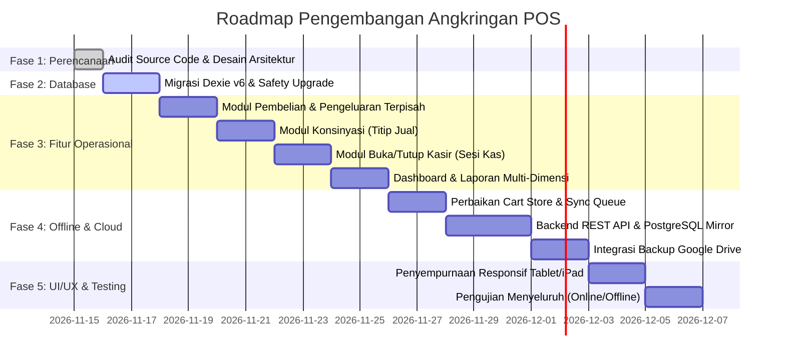

# Peta Jalan Implementasi (Implementation Roadmap) Angkringan POS

Dokumen ini menjabarkan rencana bertahap pengembangan aplikasi Angkringan POS dari kondisi saat ini menjadi sistem kasir offline-first modern yang tangguh.

---

## Ringkasan Eksekutif Fase Pengembangan

---

## Rincian Per Fase

### FASE 1 — AUDIT DAN PERENCANAAN (Fase Saat Ini)
- **Tujuan:** Memahami fondasi source code, mendokumentasikan fitur lama, mengidentifikasi risiko migrasi, dan membuat blueprint teknis tanpa mengubah kode sumber.
- **Output:**
  1. `docs/DATABASE_SCHEMA.md` (Spesifikasi Dexie v6 & PostgreSQL)
  2. `docs/SYSTEM_ARCHITECTURE.md` (Diagram offline-first, alur data, rumus keuangan)
  3. `docs/IMPLEMENTATION_ROADMAP.md` (Rencana kerja dan daftar file)
- **Kriteria Lolos:** Persetujuan pengguna terhadap hasil audit dan rancangan sistem.

---

### FASE 2 — DATABASE & MIGRATION SAFETY
- **Tujuan:** Memperluas skema Dexie.js ke Version 6 dengan mekanisme migrasi tanpa kehilangan data historis (*zero data loss*).
- **Tugas Utama:**
  1. Menambahkan kolom `uuid`, `created_at`, `updated_at`, `sync_status` pada model data yang ada di `src/lib/db.ts`.
  2. Menulis fungsi `db.version(6).stores({...}).upgrade(tx => ...)` yang secara otomatis mengisi UUID bagi rekaman lama yang belum memilikinya.
  3. Mendaftarkan tabel baru: `purchases`, `purchase_details`, `consignors`, `consignment_batches`, `consignment_items`, `consignment_settlements`, `cash_sessions`, `sync_queue`, `app_settings`, dan `backup_history`.
  4. Menyediakan modul helper database transaction untuk atomic writes (misal: simpan penjualan + kurangi stok + potong konsinyasi).
- **Kriteria Pengujian:**
  - Aplikasi dapat membuka database lama tanpa error.
  - Seluruh data transaksi, menu, dan pengeluaran historis tetap muncul di antarmuka.
  - Eksekusi `npm run build` dan linter bersih tanpa error tipe TypeScript.

---

### FASE 3 — PENGEMBANGAN FITUR OPERASIONAL

#### Sub-fase 3A: Pembelian Barang Dagangan vs Pengeluaran Operasional
- **Tugas:**
  - Membuat route/halaman baru untuk pencatatan kulakan (pembelian rokok, minuman kemasan, snack).
  - Merestrukturisasi halaman `pengeluaran.tsx` agar murni mencatat beban operasional (es batu, arang, listrik, gas, kebersihan).
  - Otomatisasi integrasi stok gudang: pembelian barang kulakan langsung meng-update stok dan modal satuan di `inventory`.

#### Sub-fase 3B: Manajemen Konsinyasi (Titip Jual)
- **Tugas:**
  - Membuat antarmuka kelola penitip (*consignors*).
  - Form penerimaan barang titipan (batch masuk, harga jual, harga setor ke penitip).
  - Integrasi dengan menu kasir agar saat menu konsinyasi terjual, status batch tercatat.
  - Fitur rekapitulasi 14 hari: input retur, kalkulasi otomatis barang laku, hitung hak setor ke penitip, dan pencatatan pembayaran setoran tunai.

#### Sub-fase 3C: Sesi Buka & Tutup Angkringan (Cash Sessions)
- **Tugas:**
  - Fitur Buka Kas: input modal awal kas di laci saat angkringan mulai beroperasi.
  - Mengaitkan transaksi penjualan tunai, pembelian tunai, pengeluaran tunai, dan setoran konsinyasi tunai ke sesi kas aktif (`session_id`).
  - Fitur Tutup Kas: rekonsiliasi kas otomatis. Kasir memasukkan jumlah uang fisik riil di laci; sistem menghitung selisih kas secara transparan.

#### Sub-fase 3D: Dashboard & Laporan
- **Tugas:**
  - Mengembangkan halaman Dashboard utama (penjualan hari ini, pengeluaran hari ini, pembelian hari ini, status kasir buka/tutup, status backup).
  - Memperbarui halaman laporan dengan tab: Penjualan, Pembelian, Pengeluaran, Konsinyasi, dan Rekap Penutupan Kas Harian.

---

### FASE 4 — OFFLINE-FIRST, SINKRONISASI & BACKUP CLOUD

#### Sub-fase 4A: State Management Keranjang & Sync Queue
- **Tugas:**
  - Mengisolasi keranjang belanja (`cart-store.ts`) agar tahan refresh browser dan crash aplikasi.
  - Mengimplementasikan `sync_queue` di Dexie untuk merekam mutasi data (`insert`, `update`, `delete`).

#### Sub-fase 4B: Backend REST API & PostgreSQL Mirror
- **Tugas:**
  - Membangun REST API ringan (Node.js/Hono/Express) dengan database PostgreSQL.
  - Endpoint sinkronisasi batch: menerima antrean mutasi lokal dan melakukan *upsert* idempoten berdasarkan `uuid`.
  - Endpoint kesehatan koneksi (*ping/heartbeat*).

#### Sub-fase 4C: Integrasi Backup Google Drive & Lokal
- **Tugas:**
  - Backup otomatis: saat perangkat mendeteksi koneksi online, buat snapshot JSON terenkripsi/terverifikasi checksum SHA-256 dan upload ke folder khusus Google Drive melalui backend.
  - Backup manual: tombol satu-klik simpan ke penyimpanan lokal perangkat (Capacitor Filesystem / Download browser) atau simpan ke Google Drive.
  - Restore aman: pembuatan *emergency snapshot* sebelum file cadangan ditimpa ke database lokal.

---

### FASE 5 — PENYEMPURNAAN UI/UX & PENGUJIAN MENYELURUH
- **Tugas:**
  - Implementasi layout responsif:
    - Smartphone (`< 768px`): Bottom sheet cart, navigasi bawah yang besar.
    - Tablet / iPad (`≥ 768px`): Split screen kasir (kiri katalog menu, kanan keranjang & pembayaran langsung).
  - Skema warna konsisten: warm cream, white, amber/brown dengan kontras tinggi dan dark mode tetap aktif.
  - Pengujian skenario kritis:
    1. Transaksi tanpa internet sama sekali (offline).
    2. Transaksi dengan pergantian jaringan mendadak (offline -> online -> offline).
    3. Perhitungan rekonsiliasi kas (modal awal + tunai masuk - tunai keluar).
    4. Pengujian retur konsinyasi dan kalkulasi setoran.
    5. Pengujian backup dan pemulihan data (restore).

---

## Daftar File yang Akan Diubah dan Dibuat

### File yang Perlu Dimodifikasi:
1. `src/lib/db.ts` — Upgrade ke Dexie Version 6, definisi model TypeScript, fungsi migrasi aman.
2. `src/lib/cart-store.ts` — Penyempurnaan state persistence & session coupling.
3. `src/routes/__root.tsx` — Penyesuaian navigasi (Dashboard, Kasir, Riwayat, Biaya/Beli, Konsinyasi, Laporan, Kelola).
4. `src/routes/index.tsx` — Peningkatan kasir (nomor invoice otomatis, layout responsif tablet/iPad, integrasi sesi kas).
5. `src/routes/pengeluaran.tsx` — Pemisahan murni untuk biaya operasional non-kulakan.
6. `src/routes/kelola.tsx` — Penambahan manajemen konsinyasi, verifikasi backup, dan pengaturan sistem.
7. `src/routes/laporan.tsx` — Penambahan laporan pembelian, konsinyasi, dan penutupan kas harian.
8. `src/routes/riwayat.tsx` — Penambahan filter berdasarkan nomor nota dan sesi kas.

### File Baru yang Akan Dibuat:
1. `src/routes/dashboard.tsx` — Dashboard ringkasan harian dan status sistem.
2. `src/routes/pembelian.tsx` — Pencatatan kulakan barang dagangan.
3. `src/routes/konsinyasi.tsx` — Modul lengkap titip jual barang & setoran.
4. `src/routes/sesi-kas.tsx` — Alur buka dan tutup kasir harian.
5. `src/lib/sync-service.ts` — Worker antrean sinkronisasi background.
6. `src/lib/backup-service.ts` — Modul verifikasi checksum, local backup, dan Google Drive backup.
7. `server/` (Direktori Backend Cloud) — Layanan REST API, skema migrasi PostgreSQL, dan integrasi Google Drive API.
