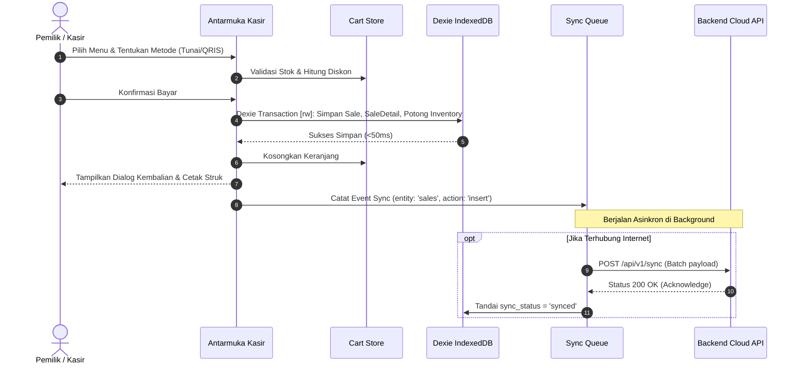
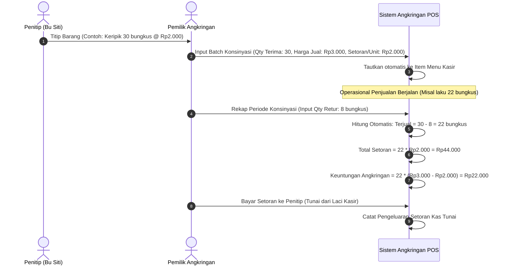

# Arsitektur Sistem Angkringan POS (Offline-First Single Device)

Dokumen ini menjelaskan arsitektur sistem, alur data transaksi, strategi sinkronisasi cloud, mekanisme backup Google Drive, serta kalkulasi keuangan aplikasi Angkringan POS.

---

## 1. Diagram Arsitektur Tingkat Tinggi

```mermaid
flowchart TD
    subgraph Client ["Client Device (Android Tablet / iPad / Smartphone)"]
        UI["UI Layer (React 19 + Tailwind + Radix UI)"]
        State["State Layer (Dexie Hooks + Cart Store)"]
        LocalDB[("Local Database (IndexedDB via Dexie.js v6)")]
        SyncManager["Background Sync Worker / Queue"]
        CapacitorFS["Capacitor Filesystem (Storage Lokal)"]
    end

    subgraph Backend ["Cloud Infrastructure (Layanan Cloud Backend)"]
        API["Backend REST API (Node.js/Hono/Express)"]
        CloudDB[("PostgreSQL Database (Cloud Replikasi)")]
        GDriveService["Google Drive Service (OAuth2 Server-side)"]
    end

    subgraph CloudStorage ["Google Cloud Storage"]
        GDrive[("Google Drive Backup Folder")]
    end

    UI -->|1. Aksi Kasir / Catat Biaya| State
    State -->|2. Transaksi Tulis Segera| LocalDB
    LocalDB -->|3. Reaktif Update UI (LiveQuery)| UI
    LocalDB -->|4. Masukkan Perubahan ke Antrean| SyncManager
    
    SyncManager -.->|5. Cek Koneksi Internet| NetworkCheck{Online?}
    NetworkCheck -- Ya -->|6. Kirim Batch Data Idempoten| API
    NetworkCheck -- Tidak -->|Tetap Antre di IndexedDB| SyncManager
    
    API -->|7. Upsert Transaksi via UUID| CloudDB
    API -->|8. Ekspor JSON Enkripsi & Upload| GDriveService
    GDriveService -->|9. Arsip Backup Harian| GDrive
    
    UI -->|10. Backup Manual File Lokal| CapacitorFS
```

---

## 2. Prinsip Wajib Offline-First

1. **Zero-Latency Transaksi:** 
   Kasir melayani pelanggan dengan cepat. Setiap penekanan tombol "Bayar" atau "Simpan" langsung masuk ke IndexedDB lokal dalam kurun waktu `< 50ms`. Antarmuka tidak boleh menampilkan loading spinner menunggu respon jaringan internet.
2. **Kemandirian Penuh Tanpa Server:**
   Seluruh fitur inti (buka kasir, input pesanan, cetak nota/struk, catat pengeluaran, input kulakan, hitung konsinyasi, dan tutup kas harian) tetap berfungsi normal 100% saat tidak ada koneksi internet (mode offline).
3. **Idempotensi Sinkronisasi:**
   Setiap transaksi memiliki `uuid` (UUID v4) yang di-generate di perangkat lokal. Saat data dikirim berulang kali (misal akibat sinyal putus di tengah transmisi), PostgreSQL melakukan `ON CONFLICT (uuid) DO NOTHING` atau `DO UPDATE`, sehingga tidak akan pernah terjadi transaksi ganda (*duplicate transactions*).
4. **Google Drive Bukan Database Transaksional:**
   Google Drive digunakan murni sebagai wadah arsip backup file (JSON terkompresi/terverifikasi) berkala dan cadangan darurat, bukan untuk querying data harian.

---

## 3. Alur Data & Siklus Transaksi

### A. Alur Transaksi Kasir (Point of Sale)


### B. Alur Konsinyasi (Titip Jual)


---

## 4. Rumus Keuangan & Rekonsiliasi Kas

Aplikasi menerapkan pemisahan akuntansi yang ketat agar pemilik angkringan tidak keliru membedakan omzet kas fisik dengan keuntungan riil.

### A. Rumus Kas Fisik Laci (Uang Tunai Nyata)
Hanya memperhitungkan transaksi dengan metode pembayaran **TUNAI / CASH**. Pembayaran QRIS atau transfer tidak masuk ke laci kasir:

$$\text{Kas Seharusnya} = \text{Modal Awal} + \text{Penjualan Tunai} - \text{Pembelian Tunai} - \text{Pengeluaran Tunai} - \text{Setoran Konsinyasi Tunai}$$

$$\text{Selisih Kas} = \text{Uang Tunai Aktual (Dihitung Fisik)} - \text{Kas Seharusnya}$$

- Jika $\text{Selisih} = 0$: Kas seimbang (*perfect balance*).
- Jika $\text{Selisih} < 0$: Kas tekor / selisih minus.
- Jika $\text{Selisih} > 0$: Kas lebih.

### B. Rumus Performa Laba Rugi Usaha (Income Statement)
$$\text{Penjualan Bersih (Net Sales)} = \text{Penjualan Kotor} - \text{Total Diskon}$$

$$\text{Laba Kotor (Gross Profit)} = \text{Penjualan Bersih} - \text{Total HPP Terjual}$$

$$\text{Laba Bersih Operasional} = \text{Laba Kotor} + \text{Laba Konsinyasi} - \text{Pengeluaran Operasional}$$

*Catatan Penting:* Pembelian stok/barang dagangan (kulakan) yang belum terjual dihitung sebagai **Aset Persediaan (Inventory Asset)**, bukan beban langsung, agar laporan laba rugi bulanan akurat.

---

## 5. Strategi Backup, Restore, dan Google Drive

### A. Format Arsip Backup
File backup berformat JSON terstruktur dengan metadata verifikasi:
```json
{
  "version": 6,
  "app_version": "1.0.0",
  "backup_id": "urn:uuid:6ba7b810-9dad-11d1-80b4-00c04fd430c8",
  "timestamp": 1731667200000,
  "checksum": "sha256_hash_string",
  "data": {
    "cash_sessions": [...],
    "categories": [...],
    "menu_items": [...],
    "inventory": [...],
    "sales": [...],
    "sale_details": [...],
    "purchases": [...],
    "purchase_details": [...],
    "expenses": [...],
    "consignors": [...],
    "consignment_batches": [...],
    "consignment_items": [...],
    "consignment_settlements": [...]
  }
}
```

### B. Protokol Restore Aman (Safety Restore Protocol)
1. **Pre-Restore Snapshot:** Sebelum file baru dipulihkan ke IndexedDB, sistem otomatis membuat snapshot cadangan darurat lokal (`emergency_backup_pre_restore.json`).
2. **Validasi Skema & Checksum:** File backup divalidasi struktur JSON-nya dan dicocokkan dengan versi skema.
3. **Database Transaction:** Proses `bulkPut` dilakukan dalam satu transaksi Dexie terisolasi. Jika terjadi kegagalan di tengah jalan, seluruh operasi di-*rollback*.

### C. Keamanan Kredensial Google Drive
- **Tidak Menyimpan Secret di Frontend:** Frontend React / Capacitor **TIDAK PERNAH** menyimpan `client_secret` Google OAuth atau Refresh Token yang rentan di-decompile dari APK Android.
- **Backend Token Exchange:** Frontend hanya menerima *auth state* atau token akses terbatas dari backend REST API yang mengelola kredensial Google Cloud Platform melalui variabel lingkungan aman (`.env`).

---

## 6. Desain Antarmuka Multi-Device (Smartphone, Tablet, iPad)

| Perangkat | Breakpoint | Karakteristik Tata Letak |
| :--- | :--- | :--- |
| **Smartphone Android** | `< 768px` | Tata letak satu kolom vertikal. Keranjang belanja menggunakan *Bottom Sheet Drawer* yang dapat dibuka-tutup dengan sentuhan jempol. Navigasi berada di *Bottom Navigation Bar* setinggi 80px dengan tombol ramah layar sentuh (`min-h-12`). |
| **Tablet Android & iPad** | `≥ 768px` | Tata letak dua kolom berdampingan (*Split-Pane POS*):<br>• Kolom Kiri (60-65%): Grid menu dengan filter kategori tab.<br>• Kolom Kanan (35-40%): Panel keranjang belanja persisten, rincian pembayaran, dan tombol bayar instan tanpa perlu bolak-balik membuka modal. Navigasi sisi kiri (*Sidebar Navigation*). |
| **Desktop / Laptop** | `≥ 1024px` | Sidebar navigasi tetap di kiri, area kerja lapang dengan pintasan keyboard (*shortcuts*) untuk kasir cepat. |
